# Create a game

Make a new game on a blank floppy: the user disk a game keeps its saves on. Kairo88 makes a blank 2D floppy, unformatted as a new floppy was. On the PC-8801 a game formats its own user disks (N88-BASIC has no FORMAT), so the game prepares it. The game and its disks can stay wherever they are (for example in Download): the Disks page takes them from anywhere on the device, and Restart keeps them in the drives.

This example makes a Sorcerian user disk.

## 1. Create the blank floppy

Open the library menu › **Manage library**. Under **New game**, choose **Floppy disk · 320 KB · 2D**, name it, and press **Create**. Kairo88 makes a folder of that name in your games folder with the blank floppy in it.

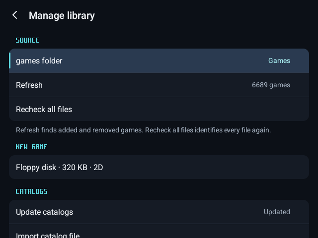

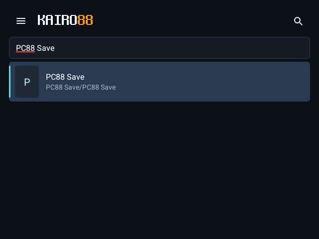

## 2. Put in the game

Press **Play**, then open the menu › **Disks**. The new floppy is this game's own disk: put it in **Drive 2** (it is listed under **This game**).

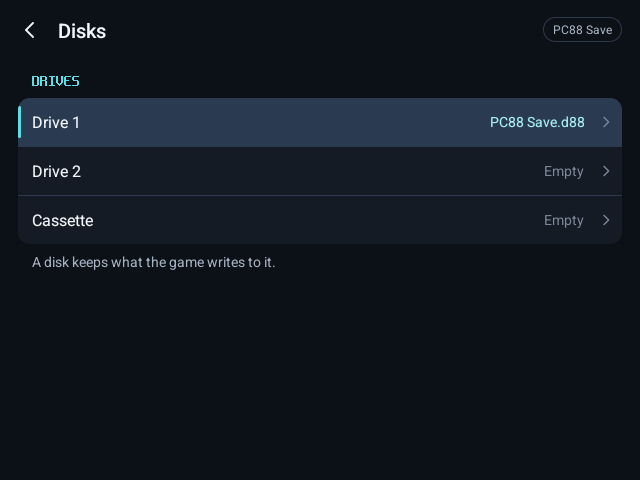

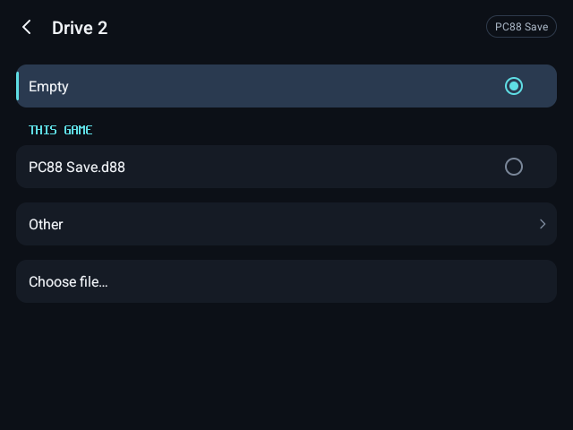

Put the game's program disk in **Drive 1** with **Choose file…**, from wherever it is.

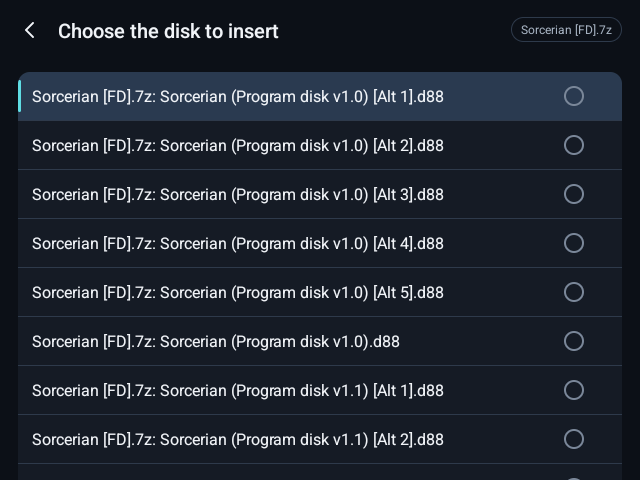

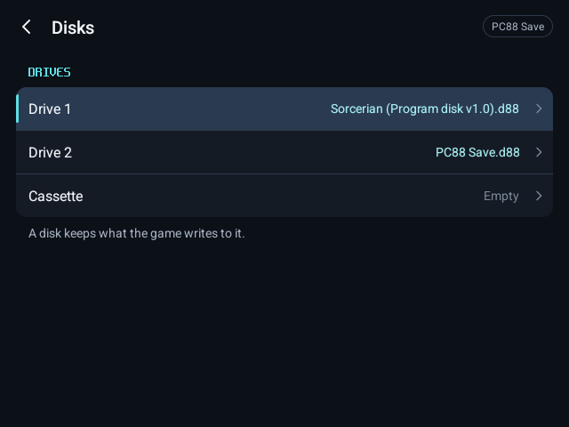

Menu › **Restart game**: the PC-8801 starts again with both disks in and boots the game.

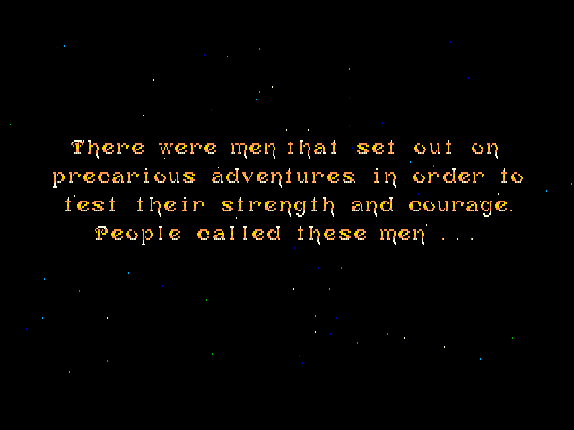

## 3. Let the game format it

Open the game's own user disk tool. In Sorcerian: the menu's ユーティリティー (with its utility disk in Drive 2), then ユーザーディスクツール.

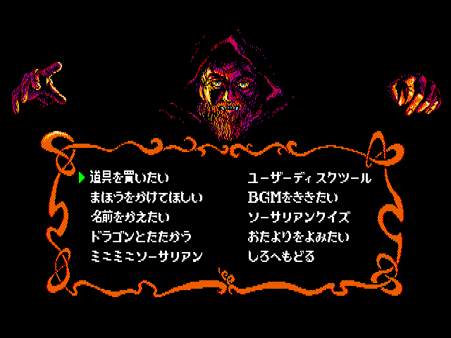

Swap the new floppy back into Drive 2 (Disks › Drive 2 › your new game's disk) and choose **FORMAT**.

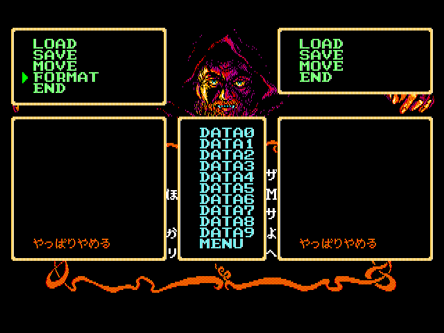

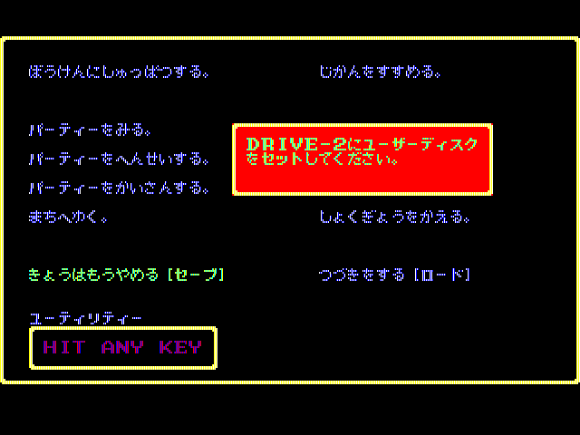

## 4. Play and save

The floppy is now the game's user disk: save to it from the game as usual.

## 5. It keeps what is written

The floppy is in your library under the name you gave it, and everything written to it stays on it between sessions.

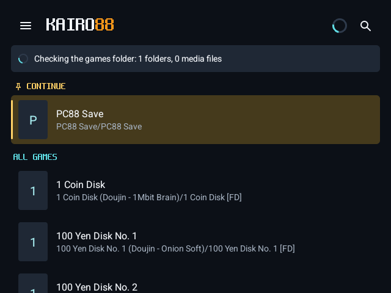
